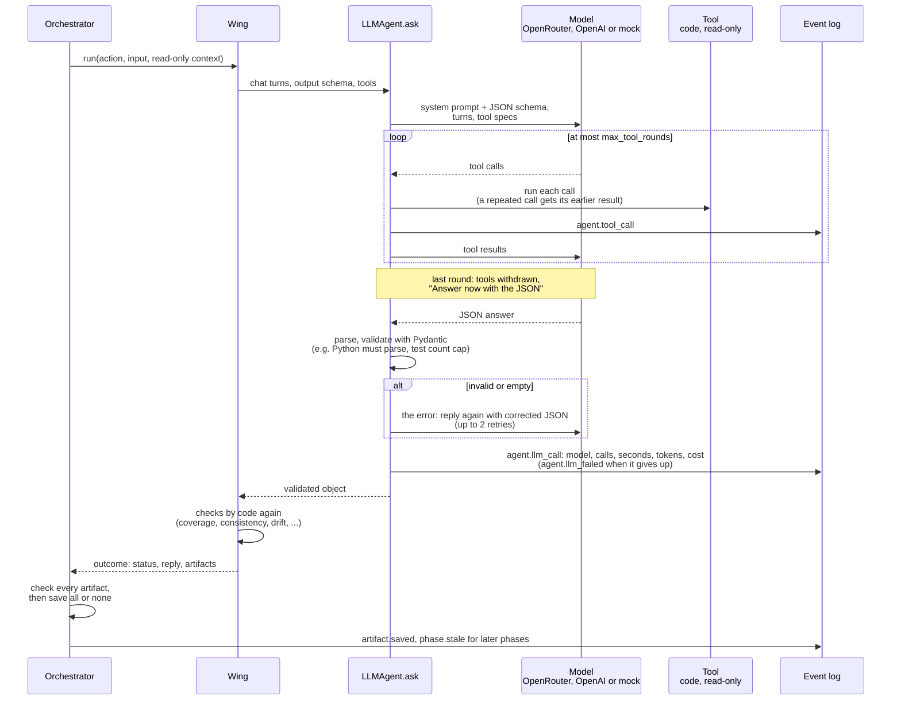

# Wings

An AI-assisted software engineering environment built for the course *Coding with AI* (University of St. Gallen, WS 2026, Prof. Dr. Guido Salvaneschi).

A developer describes the software they want. A team of LLM agents turns it into requirements, UML design, code, tests and a deployment, and keeps all of it consistent while the software changes. After every phase the developer sees the result, discusses it, edits it and approves it before the pipeline moves on.

The name comes from the project brief: code generation is the body of the bird, but it does not fly without the wings, everything before and after the code.

## Status

| Phase | Wing | State |
|---|---|---|
| P1 Requirements | left | working: clarifying questions, structured requirements with stable IDs, developer edits |
| P2 Design | left | working: PlantUML use case, class and sequence diagrams, requirement coverage check |
| P3 Design refinement | left | working: reviewer findings (code checks first), apply picked findings or comment on a diagram, the whole set is updated consistently |
| P4 Code generation | body | working: Python files from the refined design, every file parsed, classes compared with the class diagram |
| P5 Testing | right | working: pytest files named after requirements, run for real, results per requirement, a debugger that fixes a wrong test or sends the fix to the code |
| P6 Deployment | right | working: Dockerfile and start scripts, checked by code, program started once for real (Docker itself is not run) |
| P7 Maintenance | right | working: change requests with impact from the trace and a first step in the right phase; consistency check of design, code and tests; hand edits in the project folder detected, imported on request and checked against the design |

Every phase runs on the free scripted demo model and on OpenAI or OpenRouter. All checks marked "by code" are deterministic: the model proposes, code verifies.

## Quick start

Requirements: Python 3.12 or newer, Node 20 or newer. Diagrams as pictures: open **Settings → Diagrams** and either use plantuml.com (one click, sends the diagram text to the public server) or download PlantUML to this computer (needs Java 17+). Graphviz is not needed.

```bash
cd backend
python -m venv .venv
.venv/Scripts/python -m pip install -e ".[dev]"     # on macOS/Linux: .venv/bin/python
.venv/Scripts/python -m uvicorn wings.main:app --port 8810
```

```bash
cd frontend
npm install
npm run dev     # open http://localhost:5190
```

By default Wings runs on a **scripted demo model** (a to-do app scenario), so everything works without an API key and without cost. To use real models, open **Settings** at the bottom of the sidebar, choose OpenAI (or OpenRouter), paste your API key and press Save. Wings writes it to `.env` (git-ignored) and uses it at once; "Test connection" checks it. You can also edit `.env` by hand, see `.env.example`.

## Your own project folder

Each project can live in a folder of your choice, for example `C:\Projects\todo-app`. Set it on the start page ("Save the files in a folder on this computer") or later under **Folder** in the sidebar: **Browse…** opens the Explorer (or Finder) folder dialog, or paste the path. The folder must be new or empty; if you pick one that already has files, Wings suggests a new subfolder named after the project. The dialog needs Tkinter, which the Python installers for Windows and macOS include.

- After every step Wings writes the files there: code, tests, `Dockerfile` and start scripts at the top, requirements, diagrams and reports in `docs/wings/`. Open it in your editor, run it from a terminal, put it under git.
- Edit anything in your own editor. Wings notices (a banner and a count next to **Folder**) and never overwrites your change.
- **Import** takes your edits over as new revisions by you. The step they belong to goes back to review, later steps become out of date, and design and code are compared again by code. If they disagree (for example a new method that is not in the class diagram), you get two buttons: update the design from the code, or the code from the design. New `.py`, `.html`, `.css` and `.js` files and deleted code files are taken over too; `.puml` diagrams can be edited the same way.
- **Restore Wings' version** drops an edit.

The same from the command line: `wings create "Todo" --folder C:\Projects\todo-app`, `wings folder <project>`, `wings folder <project> --import`. Design and limits: ADR 0015.

## How it is built

- Backend: Python, FastAPI, ports and adapters. Each phase is a self-contained package (a "wing") registered in a pipeline; an orchestrator enforces approval gates and marks later phases stale when something earlier changes. See `docs/code/architecture.md`.
- Agents: one or more LLM agents per wing (analyst, architect, ...), each with its own prompt file and model tier. They communicate through versioned artifacts, not with each other.
- Frontend: React and TypeScript. The seven phases are a checklist in the sidebar; each phase has a conversation, actions generated from the backend's schemas, editable results (requirements, diagrams, review findings, files, test results, checks, changes) and next-step buttons the agents propose; a traceability matrix links requirements to diagrams, code, tests and the latest test result. Visual system: `docs/code/design.md`.
- Agents use deterministic tools while they work (the architect checks PlantUML syntax, class/sequence consistency and requirement coverage; the coder parses its files and compares them with the design; the impact analyst looks up the trace).
- The developer's project folder is a second copy of the files, synced both ways by deterministic rules (`domain/sync.py`): Wings writes after every change but never over a hand edit; hand edits become revisions only when the developer imports them (ADR 0015).
- Generated code and tests run in a local sandbox (temporary folder, timeout, no secrets in the environment). See ADR 0013 for what it protects and what it does not.
- Wings is also an MCP server (`wings-mcp`): Claude Desktop, Claude Code or Cursor can drive every phase. See `docs/code/wings.md`.
- Developers can attach documents (text, Markdown, PDF, Word) to any message; the agents read their text.
- Every phase action is also reachable through the HTTP API (`/docs`) and the CLI (`wings run <project> <phase> <action>`, `wings attach <project> <file>`).

## Architecture

Wings has nine LLM agents in seven wings. Agents never talk to each other. Each one reads artifacts that earlier phases saved, answers with JSON that matches a schema, and its wing turns the answer into new artifact revisions. The orchestrator is plain code (no LLM): it runs one action per project at a time, checks every artifact before it saves the first, opens a phase only when the phases before it are accepted, marks later phases out of date when an earlier one changes, and writes every step to the event log.

### Agents and artifact flow

Rounded boxes are agents (name, model tier, what they read), slanted boxes are the artifacts they write, hexagons are checks done by code. A dashed arrow is a step the developer starts: between phases it is Accept (where a gate is shown, code must agree first), inside a phase it is picking findings or asking why tests fail. Each agent reads the artifacts named in its box.

```mermaid
%%{init: {"flowchart": {"rankSpacing": 30, "nodeSpacing": 30}}}%%
flowchart TB
  dev(["Developer: describes, answers, edits, accepts each step"])

  subgraph P1["P1 Requirements"]
    analyst("analyst (mid)<br/>asks questions, writes requirements")
    req[/"requirements<br/>REQ ids assigned by code"/]
  end

  subgraph P2["P2 Design"]
    architect("architect (frontier)<br/>reads: requirements<br/>draws the UML kinds the developer chose")
    dia[/"diagram-*<br/>PlantUML, covers REQ ids"/]
    v2{{"code: PlantUML syntax, class vs sequence,<br/>kinds chosen vs drawn<br/>gate: every functional REQ in a diagram"}}
  end

  subgraph P3["P3 Design refinement"]
    reviewer("reviewer (frontier)<br/>reads: requirements, design")
    rev[/"review<br/>findings: code checks first, then the reviewer's"/]
    refiner("refiner (frontier)<br/>applies picked findings or a comment<br/>to the whole diagram set")
    ref[/"refined-*<br/>refined diagrams"/]
    v3{{"code: consistency and coverage<br/>of every refined set"}}
  end

  subgraph P4["P4 Code generation"]
    coder("coder (mid)<br/>reads: requirements, current design")
    src[/"source-*, code-gaps"/]
    v4{{"code: every file parses,<br/>drift against the class diagram"}}
  end

  subgraph P5["P5 Testing"]
    tester("tester (mid)<br/>reads: requirements, design, code")
    tst[/"test-*, test-gaps"/]
    v5{{"code: real pytest run, injected bugs<br/>test-report, test-strength, fix-log<br/>gate: green run on the current files"}}
    debugger("debugger (frontier)<br/>is the code or the test wrong?<br/>rewrites a wrong test, or proposes<br/>a code fix as a next step for P4")
  end

  subgraph P6["P6 Deployment"]
    deployer("deployer (mid)<br/>reads: code, runtime diagrams")
    dep[/"deploy-*<br/>Dockerfile, start scripts, DEPLOY.md"/]
    v6{{"code: static checks, smoke run<br/>deployment-check, run-guide<br/>gate: check passed on the current files"}}
  end

  subgraph P7["P7 Maintenance"]
    impact("impact_analyst (mid)<br/>reads: requirements, the trace")
    chg[/"change-n<br/>impact from the trace, baseline<br/>first step: revise P1 (change) or P4 (bug)"/]
    v7{{"code: consistency check<br/>drift, status of every REQ id"}}
  end

  dev --> analyst --> req
  req -.-> architect
  architect --> dia --> v2
  v2 -.-> reviewer
  reviewer --> rev
  rev -.-> refiner
  refiner --> ref --> v3
  v3 -.-> coder
  coder --> src --> v4
  v4 -.-> tester
  tester --> tst --> v5
  v5 -. "failures with file and line" .-> debugger
  v5 -.-> deployer
  deployer --> dep --> v6
  v6 -.-> impact
  impact --> chg
  chg -. "runs again when a change is through" .-> v7
```



The same in a table, as the code has it (`phases/*/module.py`, `application/tools.py`):

| Wing | Agents (tier), tools | Reads | Agent writes | Code writes or checks |
|---|---|---|---|---|
| P1 Requirements | analyst (mid), no tools | developer's text, attached documents | `requirements` | REQ ids assigned and kept by code, never by the model |
| P2 Design | architect (frontier); `check_plantuml`, `check_consistency`, `check_coverage`; 2 tool rounds (simple) or 4 (detailed) | `requirements` | `diagram-*` with the REQ ids each covers | after the answer: coverage, class vs sequence consistency, kinds chosen vs drawn; accept only when every functional REQ is in a diagram |
| P3 Refinement | reviewer (frontier), refiner (frontier); the three design tools | `requirements`, current design | `review` (findings), `refined-*` | syntax, consistency and coverage problems become findings before the reviewer runs; each refined set is checked again |
| P4 Code | coder (mid); `compare_with_design`, 2 tool rounds | `requirements`, current design (refined if it is newer) | `source-*`, `code-gaps` (what it says it did not meet) | a file that does not parse is refused; drift between class diagram and code |
| P5 Testing | tester (mid), no tools; debugger (frontier), `check_python` | `requirements`, design, `source-*`; debugger also the failures, their lines and `fix-log` | `test-*`, `test-gaps`; debugger may rewrite a wrong test | test count capped; pytest runs in the sandbox (`test-report`, by code); injected bugs (`test-strength`, no model); `fix-log`; declared gaps lower `passed` to `partial` or `not_met`; accept only after a green run newer than every code and test file |
| P6 Deployment | deployer (mid), no tools | `source-*`, component and deployment diagrams if drawn | `deploy-*` (Dockerfile, `run.sh`, `run.ps1`, `DEPLOY.md`) | Dockerfile has `FROM` and `CMD`, copies only files that exist; `python -m` modules and the run guide's commands exist in the code; the smoke command starts the program in the sandbox; `deployment-check`, `run-guide`; accept only when the latest check passed on the current files. Docker itself is not run |
| P7 Maintenance | impact_analyst (mid); `trace_impact` | `requirements`, the trace | `change-<n>` (kind, affected REQ ids, plan) | unknown REQ ids dropped; impact and progress computed from the trace and a baseline; `consistency` report (drift, per requirement: diagram, code, test, result) without a model |

"Current design" is the refined copy from P3 unless P2 changed after it (ADR 0012). Every wing also has a `discuss` action: the same agent answers a question in plain text and nothing is saved. A wing never calls another wing. A next step that crosses wings (the debugger's code fix, a change request's first step) is a button the developer presses, and the orchestrator applies the usual gates.

### One agent call

`LLMAgent.ask` (`application/agent.py`) and `call_structured` (`application/structured.py`) run every structured call the same way:



| Step | Where | What it guarantees |
|---|---|---|
| System prompt | `phases/<wing>/prompts/*.md` | one prompt file per agent role, versioned in git |
| Output schema | `phases/<wing>/schema.py` | Pydantic models; validators refuse PlantUML without `@startuml`, Python that does not parse, colliding file names, too many tests |
| Tool rounds | `call_structured` | the model asks, code runs the tool; unknown tools and bad arguments go back as text; `response_format: json_object` is sent only when no tools are offered (DeepSeek never called a tool otherwise, session s03) |
| Validation and retry | `call_structured` | up to 2 retries with the error message; then `LLMOutputError`, a `phase.error` event, and nothing is saved |
| Event log | `events.jsonl` per project | `agent.tool_call`, `agent.llm_call` (tokens and cost summed over tool rounds and retries), `artifact.saved`, `phase.stale`, `phase.error`; the web server also writes every request and reply to `wings_llm.log` |
| Checks after the answer | each wing | the same checks again, so a model that skips its tools cannot skip the check |

### Model choice

- **One model on all tiers.** The course's OpenRouter key allows only `deepseek/deepseek-v4.1-flash-1017` (since 2026-11-09, with a daily budget per workspace). `config.py` sets it for the `small`, `mid` and `frontier` tiers. Recorded real runs cost little: all seven wings for about 0.08 USD (session s03), a snake game in 22 model calls for 0.089 USD (session s10).
- **Tiers anyway.** Each agent names a tier, and each tier maps to a model in Settings or `.env` (`WINGS_MODEL_SMALL`, `WINGS_MODEL_MID`, `WINGS_MODEL_FRONTIER`). The architect, reviewer, refiner and debugger use `frontier`; the analyst, coder, tester, deployer and impact analyst use `mid`; no agent uses `small` today. The reasons recorded in `docs/code/llm.md`: asking good questions matters more than raw reasoning for the analyst; keeping several diagrams consistent is the hardest task for the architect. With another key a stronger model can go to the `frontier` roles without code changes. With the course key this split has not changed anything yet, because every tier is the same model.
- **Providers.** The scripted mock (default, free; the automated tests and AI coding agents use it, no test calls a real API), OpenRouter and OpenAI, all behind one port (`LLMClient`). A direct Anthropic provider is being added on another branch (`demo/provider`); it is not part of this branch.
- **Consequence: the LLM proposes, code verifies.** A small flash model makes mistakes that look fine: a design with the text "placeholder", a reviewer saying "all diagrams are syntactically valid" when nothing was checked, a terminal program written for a browser requirement (session s03). So every fact that decides whether a step can be accepted is computed by code after the answer: REQ ids, coverage, consistency, parsing, drift, the real pytest run, the deployment check, the trace. The model's text explains; it never decides a gate.

### Known limits

True on this branch, 2026-11-25:

- **The newest flow has no recorded real-model run.** Design and test choices with fewer tool rounds (ADR 0018) and failure lines with a fix-loop memory (ADR 0019) were tested on the scripted mock only; both ADRs say so. The last recorded real run (snake, session s10) ended before either was committed.
- **Drift is partial.** It compares classes, public methods, inheritance, and attributes only where both sides are unambiguous (in the diagram written as `+name: type`). Associations, types and parameter lists are not compared. A design without a class diagram gets no drift check at all.
- **Some facts are self-reported by the model.** A diagram covers a REQ id because the architect lists it in `covers`; code does not check that the diagram really shows it. A test counts for the REQ id in its name (`test_req_003_...`). Gaps in code and tests (`code-gaps`, `test-gaps`) are declared by the coder and the tester; code only uses them to lower a result, so an undeclared gap stays invisible.
- **Green tests are not a working program.** The snake game passed 48 generated tests, but two key presses within one tick killed the snake (session s10).
- **Only Python is tested.** Wings builds Python 3.12 programs with the standard library; for web apps it also writes HTML, CSS and JavaScript, but the JavaScript is not tested (until branch `demo/tests` is merged).
- **The sandbox is not a security boundary.** Generated code runs with the developer's user rights in a temporary folder with a timeout and without secrets in its environment (ADR 0013). Docker is never run.

## Documentation

- `docs/code/`: how the code works (start with `docs/code/README.md`).
- `docs/process/`: how we built it, session by session, including which AI tools we used and what failed.
