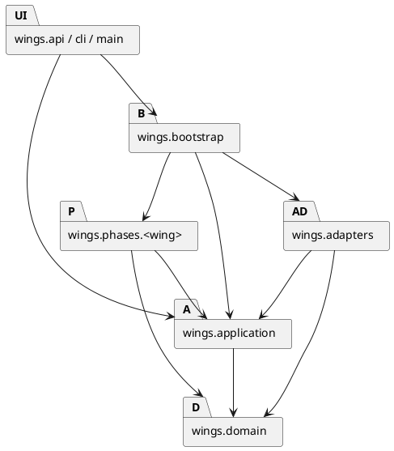
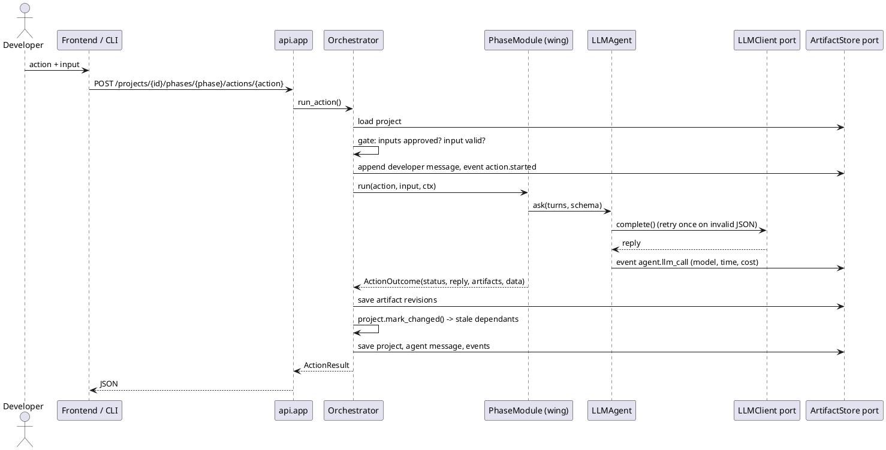

# Architecture

Ports and adapters (hexagonal architecture) with a plugin registry of phases. Decision and alternatives: `docs/process/decisions/0001-ports-and-adapters-with-phase-plugins.md`.

## Layers and what each may import

| Layer | Holds | May import | Must not import |
|---|---|---|---|
| `domain` | Project state machine, phases, artifacts, activity, trace coverage | stdlib, Pydantic | every other layer, web or HTTP libraries |
| `application` | Ports, phase contract, `LLMAgent`, registry, orchestrator, structured LLM calls | `domain` | phases, adapters, api, bootstrap, config |
| `phases/<wing>` | One wing: module, schemas, prompts | `domain`, `application` | other wings, adapters, api, bootstrap, config |
| `adapters` | Store, LLM providers, renderer, document text extraction, sandbox for generated code | `domain`, `application` (ports) | phases, api, bootstrap |
| `bootstrap` | Composition root | everything | (nothing imports it except api entry points) |
| `api`, `cli`, `main`, `mcp_server` | HTTP, command line, MCP server for AI clients | `application`, `domain`; `main`, `cli` and `mcp_server` also `bootstrap` | adapters, phases (api only) |

`backend/tests/architecture/test_layers.py` parses every module with `ast`, resolves relative imports to absolute names, and fails with `file:line imports X` if a rule is broken. It also checks that wings do not import each other, and that `domain`, `application` and `phases` import nothing but the standard library and Pydantic (and none of `subprocess`, `socket`, `urllib`, `http`): a wing that needs the outside world gets a port.

## Why this shape

- **Wings are plugins.** Each phase is a package exposing `MODULE`; `bootstrap.PHASES` lists them in pipeline order. A teammate can build P5 Testing without touching P1 to P4.
- **The orchestrator is the deterministic manager.** Gates, approvals, staleness and the activity log never depend on an LLM.
- **Ports keep the core testable.** All 170 backend tests run on the scripted mock and a temporary folder, with no network; P5 and P6 tests run generated code through the real `LocalSandbox`.
- **Agents use tools, code runs them.** An agent may call deterministic, read-only tools (`application/tools.py`: PlantUML syntax, class/sequence consistency, requirement coverage) before it answers; the agent loop runs them and logs every call as `agent.tool_call`. Tools never write: results still go through the orchestrator.
- **Wings is an MCP server.** `mcp_server.py` offers the targeted-control operations and the UML checks to AI clients over MCP (stdio). It is an entry point like the CLI and follows the same gates.

## Request flow: running a phase action

If the LLM fails (provider error or invalid output after the retry), nothing is saved, a `phase.error` event is logged and the API answers 502.

## Consistency guarantees (orchestrator and store)

| Guarantee | How |
|---|---|
| One request per project at a time | a lock per project held for load, run, save; an edit made while an agent works waits and is applied after it |
| No silent overwrite by another process (CLI next to the server) | `Project.version`; the store refuses to save a copy loaded at an older version (`ConflictError`, 409) |
| All or nothing | every returned artifact is checked (`store.check_artifact`) before the first is written; the developer's message is only stored when the action succeeded; files are written atomically (temp file and rename) |
| Wings cannot bypass the rules | a wing gets a deep copy of the project and a `ReadOnlyStore`; it may only report `draft` or `needs_input`; approval belongs to the developer |
| Files stay inside the workspace | artifact ids are lowercase slugs; paths must be relative POSIX paths, no `..`, backslashes or drive letters, and must resolve under `<project>/files` |
| The log never stops at "started" | any failure inside a wing writes a `phase.error` event |

## Error mapping

| Exception | Meaning | HTTP |
|---|---|---|
| `NotFoundError` | unknown project, phase, action or artifact | 404 |
| `PhaseLockedError` | upstream phases not approved | 409 |
| `InvalidTransitionError` | e.g. approve without output, planned wing, wing reporting a forbidden status | 409 |
| `ConflictError` | project saved by someone else meanwhile | 409 |
| `InvalidInputError`, Pydantic `ValidationError` | input the developer can fix (bad action input, invalid hand edit) | 422 |
| `ActionFailedError` | LLM unreachable, unusable output, or an internal error inside a wing | 502 |
| anything else | a bug | 500 |
