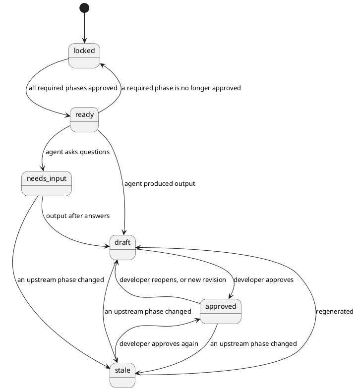

# Domain model

Code: `backend/src/wings/domain/`.

## Phases and their status

`PhaseId`: `requirements` (P1), `design` (P2), `refinement` (P3), `codegen` (P4), `testing` (P5), `deployment` (P6), `maintenance` (P7). Which phase requires which is declared by each wing (`requires`) and copied into the project when it is created.

Rules (`domain/project.py`):

- `can_run(phase)`: every phase **upstream** of it (transitively, not only the direct requirements) is `approved`. Reopening requirements therefore also stops refinement, even though design is still approved.
- `approve(phase)`: only from `draft` or `stale`, and only when the inputs are approved. Otherwise `InvalidTransitionError` or `PhaseLockedError`.
- `mark_changed(phase)`: called when a phase saves a new revision. The phase goes to `draft`; every transitive dependant with output (`draft`, `approved`) becomes `stale` and is returned in pipeline order. A dependant in `needs_input` loses its open questions (they were about the old input) and goes back to `ready` or `locked`.
- `locked` and `ready` are derived: after every transition a phase nobody worked on is recomputed from its inputs.
- `stale_cause` on a phase state names the upstream phase whose change made it stale; it is cleared whenever the phase leaves `stale`. Older `project.json` files without the field load as `null`.
- `version` counts saves; the store uses it to refuse overwriting a newer state (see `architecture.md`).
- `folder` (`domain/folder.py: OutputFolder`): the developer's own folder for the project, or `null`. It holds the absolute `path`, `synced_at`, and the manifest `files`: per folder path, the artifact id and revision Wings wrote there and a SHA-256 of the text (line endings normalized). Older `project.json` files load without it.
- Project IDs are slugs of the name (`Büro Buchung` becomes `buero-buchung`); the orchestrator appends `-2`, `-3` for duplicates.

## Artifacts

`domain/artifacts.py`. Everything a phase produces, versioned.

| Field | Meaning |
|---|---|
| `id` | stable within a project (`requirements`, `diagram-domain-classes`) |
| `kind` | `requirements` (P1), `diagram` (P2, refined copies in P3), `review` (P3), `source_file` (P4), `test_file`, `test_report`, `test_strength`, `fix_log` (P5, the attempts of the current fix loop, `domain/fixloop.py`), `deployment_file`, `deployment_check`, `run_guide` (P6), `change_request`, `drift_report` (P7), `known_gaps` (P4 `code-gaps`, P5 `test-gaps`: requirements an agent declared it could not meet or not fully test; they carry no `covers`, so they never count as trace links). Reports (`test_report`, `test_strength`, `fix_log`, `deployment_check`, `run_guide`, `drift_report`) are computed by code; their author is `system:<tool>` |
| `phase` | owning phase |
| `revision` | assigned by the store, 1, 2, 3 ... |
| `content` | structured data (JSON) |
| `text` | human-readable form (markdown, PlantUML) |
| `path` | where `text` is written in the workspace (`requirements.md`, `design/domain-classes.puml`) |
| `defines` | trace IDs introduced here (`REQ-001` ...) |
| `covers` | trace IDs this artifact implements |
| `author` | `agent:<name>` or `developer` |
| `retired` | no longer part of the current output (history kept) |

## Trace IDs and coverage

- Requirements get `REQ-001`, `REQ-002` ... assigned by code (`phases/requirements/schema.py: assign_ids`). On revisions, IDs of requirements that still exist are kept; an item that comes back without its ID (models often drop them) gets the ID of the kept requirement with the same title (case and spacing ignored, repeated titles in order), explicit IDs first; an explicit ID whose title became the title of another kept requirement is treated as that one, so an ID never moves to a different requirement; new or duplicate items get the next number after the highest ID ever issued. Every issued ID is kept in the artifact content (`issued_ids`), so the ID of a deleted requirement never comes back with another meaning. A fresh `start` keeps no old IDs.
- Diagrams list the IDs they address in `covers`.
- `domain/trace.py: requirement_coverage(artifacts)` reports which requirements no live artifact covers and which references point to IDs that do not exist. Deterministic. `trace_view(artifacts)` adds requirement and artifact titles for display; served at `GET /api/projects/{id}/trace` and shown in the design view, next to each requirement and in the traceability matrix. It leaves out P2 diagrams once P3 holds a refined copy (`without_superseded`) and carries the latest test outcome per requirement (`test_results`, read from the `test-report` artifact).
- `impact(artifacts, ids)` lists, per requirement, every live artifact whose `covers` name it (P7 change requests, the `trace_impact` tool). `requirement_status(artifacts)` says per requirement: in a diagram, implemented, tested, latest result (P7 consistency check).
- `domain/code.py: compare_design_and_code(class_diagrams, files)` compares all class diagrams of the design, read together (`domain/uml.py: class_model`), with the Python sources (`ast`), in both directions: classes, public methods, inheritance and realisation (`A <|-- B`, `B --|> A`, `B ..|> A`, `extends`, `implements` against `class B(A)`), and attributes where both sides are unambiguous. One difference gives one line: what a class inherits is reported at the parent or as the missing inheritance, not again at every child. Inheritance is met by an indirect base (also through a private class), and a `typing.Protocol` by any class with all its methods. Attributes: a `+name: type` of the diagram is met by a declared field, `self.name = ...` anywhere in the class, a property or a base class, and is not judged when the class has a base outside the files (other than ABC, Protocol, Generic, object); a field of the code counts as missing in the diagram only when it is declared in the class body (`name: type`, as in a dataclass), the diagram shows attributes for that class, and its type names no class of the diagram (that is the association line). Not compared: associations, multiplicities, parameter lists, types, private members (a name with a leading `_` in the code, and an operation marked `-` or `#` in the diagram, which is `_name` in Python: `ClassModel.hidden_operations`). `DriftReport` lists each kind in its own field; `lines()` is the text for people. `domain/testreport.py` parses pytest's JUnit XML and links a test to a requirement by its name (`test_req_003_...`). `domain/deploy.py` checks that Dockerfile and scripts copy and start only what exists, and holds the run guide (`RunGuide`: `start_command`, `url`, `example_commands`, `stop_hint`, `checked`, `derived`): `run_target` reads the module or script a `python ...` command starts, `command_problems` says why a command would start nothing, `derive_start_command` makes a start command from a smoke command by dropping its check option, `guide_checked` is true only when the passed smoke run started the same module or script. `domain/text.py` keeps chat replies short (`brief`: soft cap at a sentence end, 320 characters; `short_list`: the first five lines and a count of the rest). `domain/mutation.py` finds and picks the small bugs P5 injects into the code (`select_mutants`), judges one test run per bug (`judge`) and builds the `test_strength` report; `domain/trace.py: strength_results` returns its counts while it is newer than code and tests.
- Planned: class IDs and test IDs so the maintenance wing can follow REQ -> diagram element -> code -> test.

## Change tracking

`domain/change.py`, pure functions. A change request is followed through the phases by comparing artifact revisions, never by asking a model.

- **Baseline** (`take_baseline`): when a change is requested, the maintenance wing stores in the `change-<n>` artifact every artifact id with its revision, its retired flag and a fingerprint of text and content (`content.baseline`), plus the first step the analyst proposed (`content.first_step`).
- **Receipt** (`receipt(baseline, artifacts, phases)`): per phase the artifacts that differ from the baseline: `updated` (revision before and after; `changed` is false when the fingerprint is the same, so a file that was only written again is not sold as a change), `added`, `removed` (retired). An artifact added and retired inside the change is left out.
- **Progress** (`progress(project, phases, baseline, artifacts, first_step, planned)`): `planned` are the phases the change moves (`content.phases` of the change, names `code` and `tests` mapped to `codegen` and `testing`; default the first step's phase and its dependants). A planned phase is `done` only when the receipt has something for it (a new revision since the baseline), it is approved, and it was saved no earlier than every changed phase upstream of it. Approving a stale planned phase without updating it does not count. Every unfinished phase (planned and not done, or not approved) is open: the first is `current`, the rest `waiting`. Others are `done` (changed and approved) or `untouched`. `complete`: something changed and nothing is open. A phase the change plans is never `untouched`.
- **Next step** (`next_step`): for the current phase: answer questions (`input`), run the first step or the wing's refresh step (`run`), approve (`approve`), or a reason why it cannot go on (`blocked`: the phase's approval gate, or no refresh step).
- **Closing**: the orchestrator checks after every approval whether the newest change is complete. If so it saves a new revision of `change-<n>` (author `system:change-tracking`) with `content.closed` (`completed_at`, the frozen progress and receipt) and the receipt as text, so a later change does not rewrite what this one did. A receipt is never frozen before the last planned phase is updated. A frozen record without `planned` (written before that rule) is re-evaluated live and closed again once it is really complete. An open change that is not the newest is `dropped`: a new change can only be requested when every phase is approved, so the older one was never started.

## Output folder sync

`domain/sync.py`, pure functions (ADR 0015).

- Layout: an artifact path under `app/` goes to the top of the folder (`app/todo/models.py` -> `todo/models.py`); every other path goes under `docs/wings/` (`requirements.md` -> `docs/wings/requirements.md`).
- `plan_export(artifacts, manifest, on_disk)`: what to write and delete so the folder shows the latest live artifacts. A file whose text differs from the manifest (changed by hand), a file the developer deleted, and a file that was there before Wings wrote it are left alone (`kept`); a retired artifact's file is deleted only if unchanged.
- `folder_changes(artifacts, manifest, on_disk)`: what the developer did. `modified` (text differs from what Wings wrote), `deleted`, `added` (a new `.py`, `.html`, `.css` or `.js` file outside `docs/wings/`; data files such as `tasks.json` are ignored). `importable` by kind: source, test and deployment files and diagrams can be imported; deleting is importable for source and test files; requirements and computed reports are not. `newer_in_wings` says Wings made a newer revision since the file was written.
- Tool folders (`.git`, `.venv`, `node_modules`, caches) never count.
- A folder can be linked when it is empty: missing, or holding nothing but a fresh `.git`. Binary files, big files and dot-folders are content here, although the sync never reads them. Folder paths are compared as folders (resolved, case-insensitive on Windows), not as text.
- Without a named folder a project gets `<projects dir>/<slug>` (numbered when taken); see `architecture.md`.

## UML checks

`domain/uml.py`, pure functions used by the tools and by the design wing: `basic_problems(source)`, `parse_classes(source)` (classes, interfaces, enums with their operations, inherited along `..|>`, `--|>`, `<|--`), `sequence_participants`, `sequence_messages` (calls only; dashed replies and actors' messages left out; both resolve aliases, so `participant Game as G` and `actor "Browser page" as PAGE` report `Game` and `Browser page`, never `G` or `PAGE`), `check_consistency(class_diagram, {title: sequence})`. Small regex parsers for the PlantUML the agents write, not a full grammar; PlantUML's own syntax check runs behind the renderer port.

## Attachments

`domain/attachments.py`. Documents the developer uploads (a brief, a spec). The store keeps the original file and the extracted text (`<project>/attachments/att-001/original` and `meta.json`); ids are `att-001`, `att-002` ... An attachment is context, not phase output: uploading one changes no phase status and stales nothing.

- A developer message refers to documents in `data.attachments` (`[{id, name}]`).
- `PhaseContext.documents(phase)` returns the documents referenced by that phase's messages; `application/agent.py: document_turns(ctx, *phases)` turns them into one chat turn for the agent (20,000 characters per document, 60,000 per request).
- Text extraction is a port (`TextExtractor`); the adapter `adapters/documents.py` reads text formats, PDF (pypdf) and .docx (standard library) and refuses everything else with a reason.

## Activity

`domain/activity.py`.

- `Message`: what developer and agents said in a phase, and every decision of the developer (`role`, `text`, `author`, `data` such as open questions). Append-only; each step's messages tell its whole story (ADR 0022). Three kinds:
  - **The developer's words**: role `developer`, author `developer`.
  - **A decision of the developer**: role `developer`, author `developer`, `data.decision` = `{action, ...}` (the input as sent, without the typed words). The text is one line: the wing's `ActionSpec.decision` ("Draw: use case, class · simple", "Write focused tests", "Run the tests", "Inject up to 20 bugs, one at a time", "Apply F1 (Domain classes)"), else the action's label ("Generate code", "Review design") when the developer typed nothing. The orchestrator also records "Accepted" (or the wing's `acceptance`, e.g. "Accepted without applying F2, F4"; `data.note` carries the approval note, which is Wings' words), "Kept unchanged, although Requirements changed" (approving a stale step, `decision.kept`), "Reopened", "Edited <path> (revision n)", "Imported from your folder: ..." and "Put Wings' version back in your folder: ...". A choice and typed words are two messages, the choice first.
  - **On the developer's behalf**: what Wings does while carrying a change (`advance_change`) or catching up (`catch_up`), including the consistency check after a change: role `system`, author `wings`, `data.on_behalf` = `{"change": n}` and/or `{"catch_up": true}`. Without `data.decision` its text is the instruction Wings sent to the agent (a refresh step's text, the analyst's planned requirement revision) with `data.action` and `data.label`; with it, a line such as "Accepted on your behalf: its checks pass".
  - What agents read: `for_agents(messages)` (used by `application/agent.py: turns_from`) keeps the developer's words, agent replies and Wings' instructions (sent as user turns, so a refresh step still reaches the model) and drops every decision line. Older messages without these fields read as before.
- `Event`: what the system did, numbered per project (`seq`). Kinds used today: `project.created`, `action.started`, `agent.llm_call`, `artifact.saved`, `phase.stale`, `phase.approved`, `phase.reopened`, `phase.error`, `action.finished`, `attachment.added`, `agent.tool_call`, `change.advance`, `change.stopped`, `change.completed`, `catchup.advance`, `catchup.stopped`. A `phase.approved` event with `data.on_behalf` was an approval Wings gave while carrying change `data.change` through, at the developer's request. Summaries are written as sentences for people ("Design is out of date because Requirements changed"); machine-readable details are in `data`.
