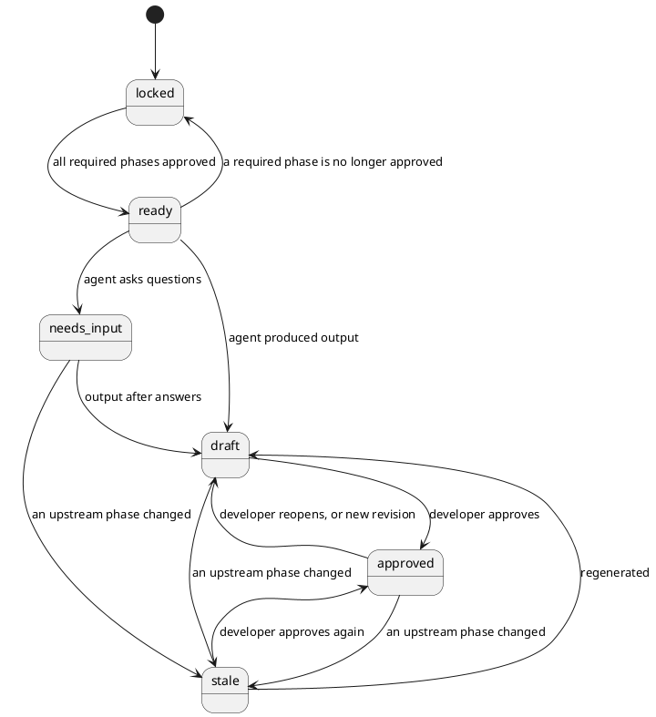

# Domain model

Code: `backend/src/wings/domain/`.

## Phases and their status

`PhaseId`: `requirements` (P1), `design` (P2), `refinement` (P3), `codegen` (P4), `testing` (P5), `deployment` (P6), `maintenance` (P7). Which phase requires which is declared by each wing (`requires`) and copied into the project when it is created.

Rules (`domain/project.py`):

- `can_run(phase)`: every phase **upstream** of it (transitively, not only the direct requirements) is `approved`. Reopening requirements therefore also stops refinement, even though design is still approved.
- `approve(phase)`: only from `draft` or `stale`, and only when the inputs are approved. Otherwise `InvalidTransitionError` or `PhaseLockedError`.
- `mark_changed(phase)`: called when a phase saves a new revision. The phase goes to `draft`; every transitive dependant with output (`draft`, `approved`) becomes `stale` and is returned in pipeline order. A dependant in `needs_input` loses its open questions (they were about the old input) and goes back to `ready` or `locked`.
- `locked` and `ready` are derived: after every transition a phase nobody worked on is recomputed from its inputs.
- `stale_cause` on a phase state names the upstream phase whose change made it stale; it is cleared whenever the phase leaves `stale`. Older `project.json` files without the field load as `null`.
- `version` counts saves; the store uses it to refuse overwriting a newer state (see `architecture.md`).
- Project IDs are slugs of the name (`Büro Buchung` becomes `buero-buchung`); the orchestrator appends `-2`, `-3` for duplicates.

## Artifacts

`domain/artifacts.py`. Everything a phase produces, versioned.

| Field | Meaning |
|---|---|
| `id` | stable within a project (`requirements`, `diagram-domain-classes`) |
| `kind` | `requirements` (P1), `diagram` (P2, refined copies in P3), `review` (P3), `source_file` (P4), `test_file`, `test_report` (P5), `deployment_file`, `deployment_check` (P6), `change_request`, `drift_report` (P7). Reports (`test_report`, `deployment_check`, `drift_report`) are computed by code; their author is `system:<tool>` |
| `phase` | owning phase |
| `revision` | assigned by the store, 1, 2, 3 ... |
| `content` | structured data (JSON) |
| `text` | human-readable form (markdown, PlantUML) |
| `path` | where `text` is written in the workspace (`requirements.md`, `design/domain-classes.puml`) |
| `defines` | trace IDs introduced here (`REQ-001` ...) |
| `covers` | trace IDs this artifact implements |
| `author` | `agent:<name>` or `developer` |
| `retired` | no longer part of the current output (history kept) |

## Trace IDs and coverage

- Requirements get `REQ-001`, `REQ-002` ... assigned by code (`phases/requirements/schema.py: assign_ids`). On revisions, IDs of requirements that still exist are kept; an item that comes back without its ID (models often drop them) gets the ID of the kept requirement with the same title (case and spacing ignored, repeated titles in order), explicit IDs first; an explicit ID whose title became the title of another kept requirement is treated as that one, so an ID never moves to a different requirement; new or duplicate items get the next number after the highest ID ever issued. Every issued ID is kept in the artifact content (`issued_ids`), so the ID of a deleted requirement never comes back with another meaning. A fresh `start` keeps no old IDs.
- Diagrams list the IDs they address in `covers`.
- `domain/trace.py: requirement_coverage(artifacts)` reports which requirements no live artifact covers and which references point to IDs that do not exist. Deterministic. `trace_view(artifacts)` adds requirement and artifact titles for display; served at `GET /api/projects/{id}/trace` and shown in the design view, next to each requirement and in the traceability matrix. It leaves out P2 diagrams once P3 holds a refined copy (`without_superseded`) and carries the latest test outcome per requirement (`test_results`, read from the `test-report` artifact).
- `impact(artifacts, ids)` lists, per requirement, every live artifact whose `covers` name it (P7 change requests, the `trace_impact` tool). `requirement_status(artifacts)` says per requirement: in a diagram, implemented, tested, latest result (P7 consistency check).
- `domain/code.py: compare_design_and_code(class_diagram, files)` compares classes and public methods (inherited ones included) of the class diagram with the Python sources (`ast`). `domain/testreport.py` parses pytest's JUnit XML and links a test to a requirement by its name (`test_req_003_...`). `domain/deploy.py` checks that Dockerfile and scripts copy and start only what exists.
- Planned: class IDs and test IDs so the maintenance wing can follow REQ -> diagram element -> code -> test.

## UML checks

`domain/uml.py`, pure functions used by the tools and by the design wing: `basic_problems(source)`, `parse_classes(source)` (classes, interfaces, enums with their operations, inherited along `..|>`, `--|>`, `<|--`), `sequence_participants`, `sequence_messages` (calls only; dashed replies and actors' messages left out), `check_consistency(class_diagram, {title: sequence})`. Small regex parsers for the PlantUML the agents write, not a full grammar; PlantUML's own syntax check runs behind the renderer port.

## Attachments

`domain/attachments.py`. Documents the developer uploads (a brief, a spec). The store keeps the original file and the extracted text (`<project>/attachments/att-001/original` and `meta.json`); ids are `att-001`, `att-002` ... An attachment is context, not phase output: uploading one changes no phase status and stales nothing.

- A developer message refers to documents in `data.attachments` (`[{id, name}]`).
- `PhaseContext.documents(phase)` returns the documents referenced by that phase's messages; `application/agent.py: document_turns(ctx, *phases)` turns them into one chat turn for the agent (20,000 characters per document, 60,000 per request).
- Text extraction is a port (`TextExtractor`); the adapter `adapters/documents.py` reads text formats, PDF (pypdf) and .docx (standard library) and refuses everything else with a reason.

## Activity

`domain/activity.py`.

- `Message`: what developer and agents said in a phase (`role`, `text`, `author`, `data` such as open questions).
- `Event`: what the system did, numbered per project (`seq`). Kinds used today: `project.created`, `action.started`, `agent.llm_call`, `artifact.saved`, `phase.stale`, `phase.approved`, `phase.reopened`, `phase.error`, `action.finished`, `attachment.added`, `agent.tool_call`. Summaries are written as sentences for people ("Design is out of date because Requirements changed"); machine-readable details are in `data`.
