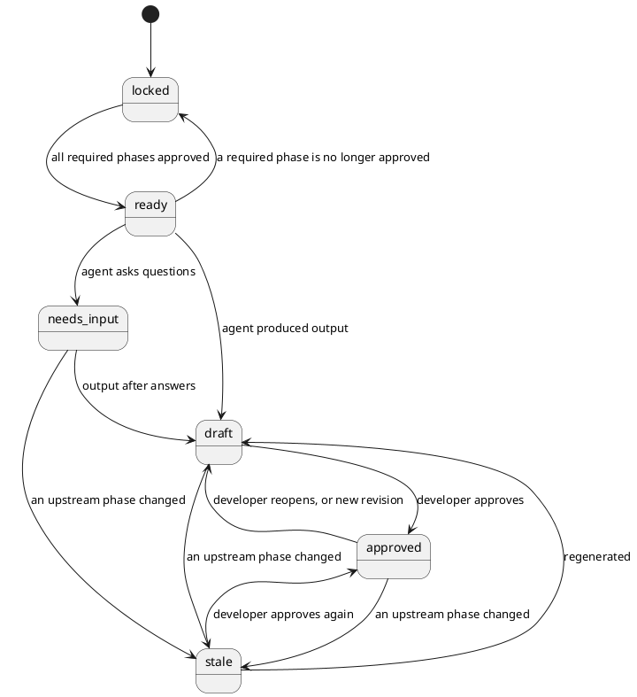

# Domain model

Code: `backend/src/wings/domain/`.

## Phases and their status

`PhaseId`: `requirements` (P1), `design` (P2), `refinement` (P3), `codegen` (P4), `testing` (P5), `deployment` (P6), `maintenance` (P7). Which phase requires which is declared by each wing (`requires`) and copied into the project when it is created.

Rules (`domain/project.py`):

- `can_run(phase)`: every phase **upstream** of it (transitively, not only the direct requirements) is `approved`. Reopening requirements therefore also stops refinement, even though design is still approved.
- `approve(phase)`: only from `draft` or `stale`, and only when the inputs are approved. Otherwise `InvalidTransitionError` or `PhaseLockedError`.
- `mark_changed(phase)`: called when a phase saves a new revision. The phase goes to `draft`; every transitive dependant with output (`draft`, `approved`) becomes `stale` and is returned in pipeline order. A dependant in `needs_input` loses its open questions (they were about the old input) and goes back to `ready` or `locked`.
- `locked` and `ready` are derived: after every transition a phase nobody worked on is recomputed from its inputs.
- `version` counts saves; the store uses it to refuse overwriting a newer state (see `architecture.md`).
- Project IDs are slugs of the name (`Büro Buchung` becomes `buero-buchung`); the orchestrator appends `-2`, `-3` for duplicates.

## Artifacts

`domain/artifacts.py`. Everything a phase produces, versioned.

| Field | Meaning |
|---|---|
| `id` | stable within a project (`requirements`, `diagram-domain-classes`) |
| `kind` | `requirements`, `diagram` (later: source file, test suite, test report, deployment) |
| `phase` | owning phase |
| `revision` | assigned by the store, 1, 2, 3 ... |
| `content` | structured data (JSON) |
| `text` | human-readable form (markdown, PlantUML) |
| `path` | where `text` is written in the workspace (`requirements.md`, `design/domain-classes.puml`) |
| `defines` | trace IDs introduced here (`REQ-001` ...) |
| `covers` | trace IDs this artifact implements |
| `author` | `agent:<name>` or `developer` |
| `retired` | no longer part of the current output (history kept) |

## Trace IDs and coverage

- Requirements get `REQ-001`, `REQ-002` ... assigned by code (`phases/requirements/schema.py: assign_ids`). On revisions, IDs of requirements that still exist are kept; new or duplicate items get the next number after the highest ID ever issued. Every issued ID is kept in the artifact content (`issued_ids`), so the ID of a deleted requirement never comes back with another meaning. A fresh `start` keeps no old IDs.
- Diagrams list the IDs they address in `covers`.
- `domain/trace.py: requirement_coverage(artifacts)` reports which requirements no live artifact covers and which references point to IDs that do not exist. Deterministic; shown in the design view and at `GET /api/projects/{id}/trace`.
- Planned: class IDs and test IDs so the maintenance wing can follow REQ -> diagram element -> code -> test.

## Activity

`domain/activity.py`.

- `Message`: what developer and agents said in a phase (`role`, `text`, `author`, `data` such as open questions).
- `Event`: what the system did, numbered per project (`seq`). Kinds used today: `project.created`, `action.started`, `agent.llm_call`, `artifact.saved`, `phase.stale`, `phase.approved`, `phase.reopened`, `phase.error`, `action.finished`.
